# JARVIS · UI Concept Design (v0.1)

사내 그룹웨어 헬퍼 **JARVIS**의 첫 번째 모듈 **Timesheets**를 위한 UI 컨셉입니다.
컨셉 이미지는 **Higgsfield** (`gpt_image_2_6`, 1k / medium, 1344×752)로 생성했습니다. 압축된 요구사항 컨텍스트는 [`CONTEXT.md`](./CONTEXT.md)에 있습니다.

> ⚠️ 이 레포는 **public**입니다. 이미지와 문서에는 **가상의 이름과 프로젝트**만 썼습니다 (Jane Park, `P-2041 Utility Work Lamp` 등).
> 실제 그룹 시트 샘플을 추가하려면 레포를 private으로 바꾸거나, 익명화한 뒤에 커밋하세요.

| 폴더/파일 | 내용 |
|---|---|
| `CONTEXT.md` | 요구사항 + 레퍼런스 시트 3종 포맷 분석 (압축 컨텍스트, 본 개발 시 먼저 읽기) |
| `screens/` | 컨셉 화면 10장 (JPEG) |
| `higgsfield/prompts.json` | 모델·파라미터·job id·프롬프트 원문 (재생성/수정용) |
| `concept-design-resources.zip` | 위 리소스 전체 압축본 |

---

## 1. 컨셉 요약

- **Bento grid** 레이아웃: 좌측 고정 내비 레일 + 우측 카드 그리드. 기능이 늘면 **레일에 메뉴만 추가**하면 되는 구조입니다.
- 1차 메뉴: **Home**(대시보드 자리만, 내용 미정) · **Timesheets** · **Settings**, 그리고 관리자 전용 **Admin**.
- 핵심 가치: **신규 그룹 프로젝트 누락 방지**. 마스터 시트를 import할 때마다 diff를 떠서 신규 프로젝트를 **오렌지 알림 카드**로 띄우고, 로컬 호칭 매핑을 유도합니다.
- 입력은 **스프레드시트형 그리드**, 입출력은 **.xlsx** (Google Sheets에서 내보낸 파일도 호환).

## 2. 디자인 시스템 (토큰 초안)

| 토큰 | 값 | 용도 |
|---|---|---|
| `--canvas` | `#F4F1EA` | 앱 배경 (웜 오프화이트) |
| `--surface` | `#FFFFFF` | 기본 카드 |
| `--sage` | `#DCE5DA` / 헤더행 `#EAF0E8` | 보조 카드(AI, 요약), 표 헤더 |
| `--primary` | `#1F4D3A` | 활성 내비, 주요 버튼, KPI 숫자 |
| `--accent` | `#F26B2A` | **경고·신규(NEW)·미매핑 전용** (남용 금지) |
| `--text` / `--muted` | `#1A1A1A` / `#6B6B6B` | 본문 / 보조 |
| 카테고리 칩 | General `#A9D4F5`, Meeting `#F7D774`, Project `#BFE3F7`, Lunch `#D9D9D9` | 30분 로그 구분 |
| 그룹 시트 밴드 | Timelog `#FFF5C2`/`#FFE0B2`, 로컬 섹션 `#E3F1DF` | 원본 엑셀의 노랑/주황/녹색을 부드럽게 바꾼 색 |

- **Radius** (2026-11-20 변경, 아이폰 같은 작은 R): 카드 16px · 메뉴/모달 12px · 버튼/입력/탭 10px · 칩/색상 견본 6px · 프로필 이니셜만 원형. Chromium에서는 `corner-shape: superellipse(1.5)`로 연속 곡선 모서리. 토큰 `--radius-card/-menu/-control/-chip`(`src/styles.css`)
- **Type**: 한글 `Pretendard`, 영문/숫자 `Inter` (또는 Plus Jakarta Sans). 페이지 타이틀 40/700, 카드 타이틀 24/700, KPI 숫자 56/800, 본문 15/500
- **Layout**: 내비 레일 168px 고정, 콘텐츠 12-col 그리드 · gap 16px · 카드 높이 120px 배수
- **컴포넌트**: `NavRail`, `PageHeader`(타이틀, 날짜 칩, `TabBar`, 액션), `BentoCard`(white/sage/orange/dark), `SheetGrid`, `CategoryPill`, `StatusPill`(Active/NEW/Invited/Unmapped), `KpiStat`, `Donut`, `AlertCard`, `AiSuggestionCard`, `WizardModal`

## 3. 정보 구조 (IA)

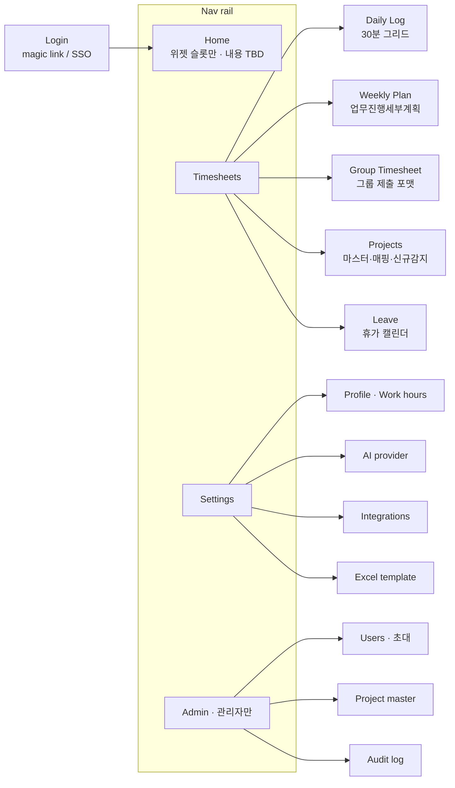

## 4. 핵심 플로우

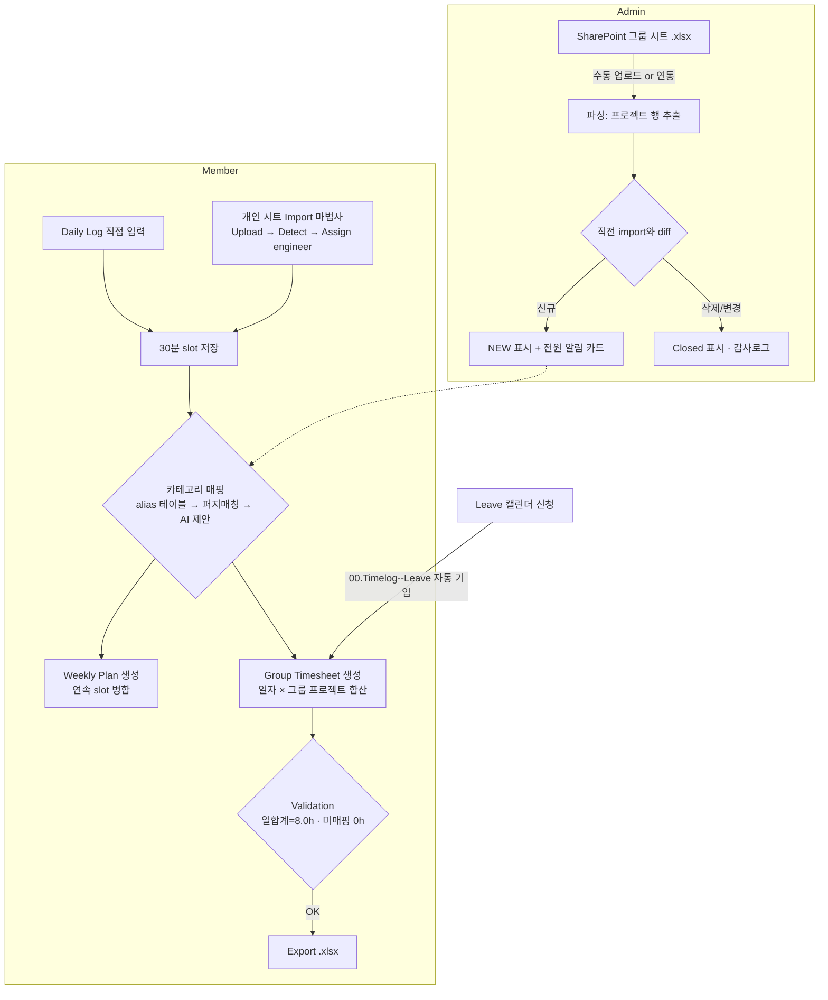

## 5. 화면별 컨셉

### 00 · Timesheets › Daily Log (스타일 마스터)
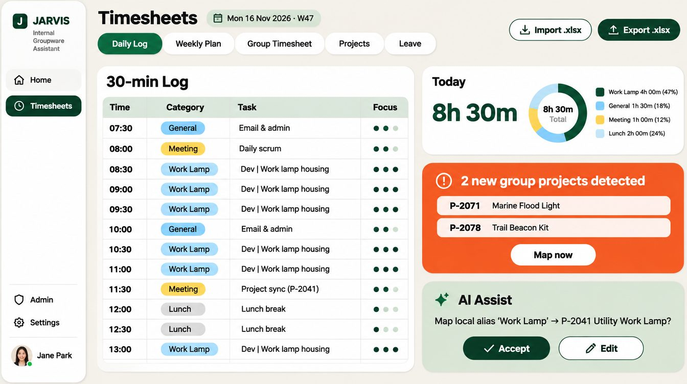
- 왼쪽 큰 카드: **30분 단위 그리드**(Time · Category · Task · Focus). 구분은 색 칩으로 표시하고, 드롭다운 값은 그룹 프로젝트와 내 로컬 alias에서 가져옵니다.
- 오른쪽 카드: **Today 합계 + 도넛**, **신규 그룹 프로젝트 알림**(오렌지), **AI Assist**(alias → 그룹 프로젝트 매핑 제안).
- 헤더 공통: 날짜/주차 칩, 하위 탭 5개, `Import .xlsx` / `Export .xlsx`.

### 01 · Login
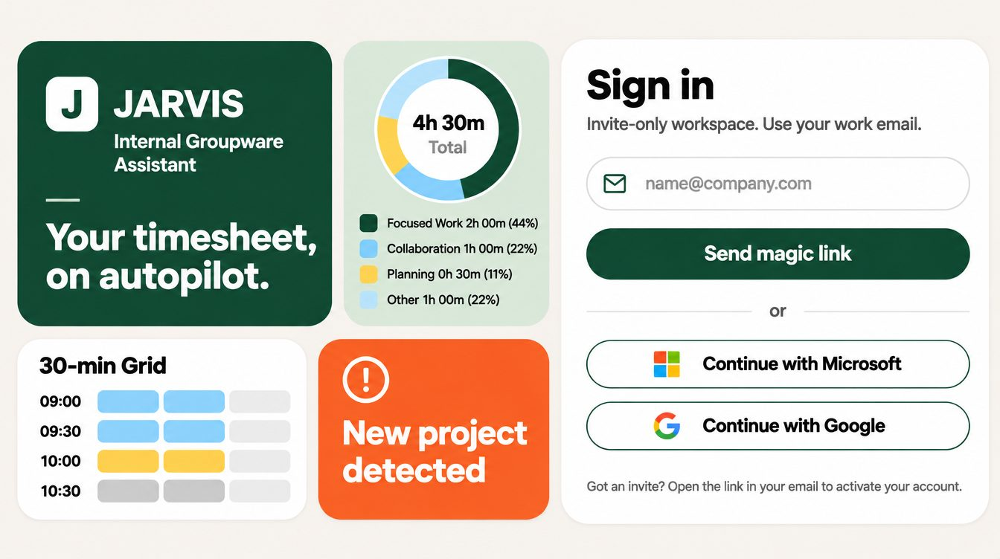
- **초대받은 사람만 쓰는 워크스페이스**. 이메일 **magic link**(또는 OTP)로 로그인하고, Microsoft/Google SSO는 옵션입니다.
- 초대 메일 링크로 처음 들어오면 계정이 활성화됩니다.

### 02 · Home (의도적으로 비움)
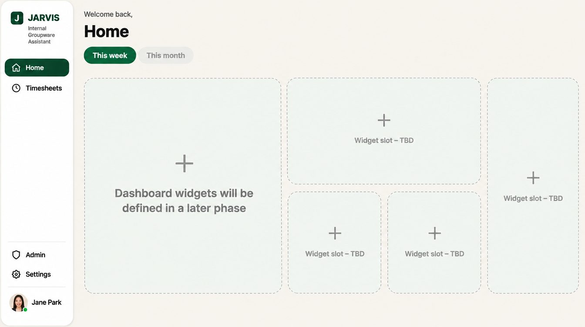
- 요청에 따라 **대시보드 내용은 정의하지 않았습니다**. Bento 슬롯 구조(2×2, 2×1, 1×1×2, 1×2)만 잡아 두었습니다.

### 03 · Timesheets › Weekly Plan (업무진행세부계획)
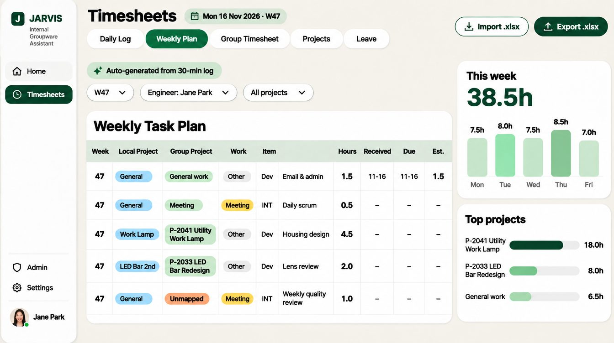
- 30분 로그에서 **자동 생성**됩니다. 연속된 동일 업무 slot을 1행으로 합칩니다.
- 기존 표 열(`Week · Project · Work · Item · Engineer · 시간 · 접수일자 · Due date · 예상시간`)에 **Group Project** 열을 추가했고, 미매핑 행은 오렌지 `Unmapped` 칩으로 표시합니다.
- 오른쪽: 주간 합계, 요일별 막대, Top projects.

### 04 · Timesheets › Group Timesheet (그룹 제출 포맷)
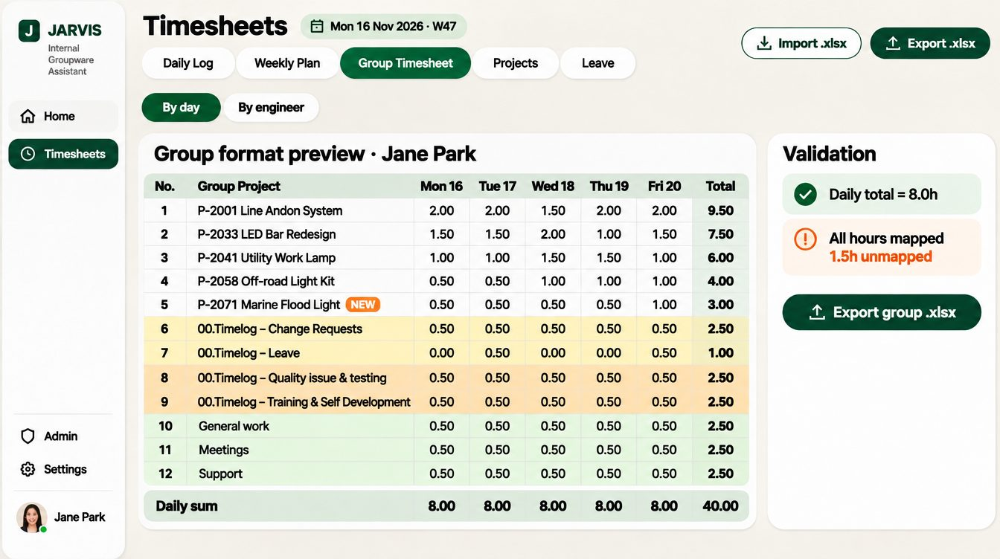
- 그룹 SharePoint 시트와 **같은 행 구성**입니다(프로젝트 → `00.Timelog--*` → 일반업무/회의/Support …).
- `By day`(한 사람의 요일별) / `By engineer`(관리자, 하루의 팀 매트릭스) 토글.
- **Validation 카드**: 일 합계, 미매핑 시간. 통과해야 `Export group .xlsx`가 활성화됩니다.

### 05 · Timesheets › Projects (마스터 · 매핑 · 신규 감지)
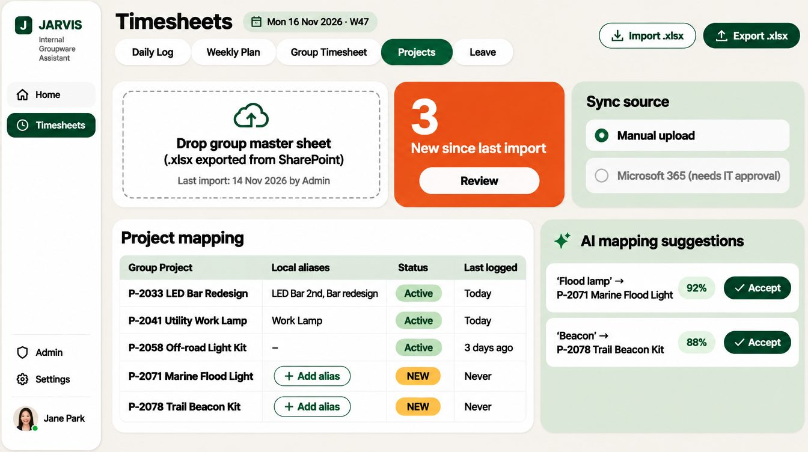
- **그룹 마스터 시트 드롭존**(SharePoint에서 받은 xlsx), 마지막 import 정보.
- **New since last import** 카운트 → Review.
- 매핑 테이블: `Group Project | Local aliases(1:N) | Status(Active/NEW/Closed) | Last logged`.
- Sync source: 지금은 Manual upload이고, Microsoft 365 연동은 IT 승인 후 켭니다(§8).
- AI 매핑 제안: 신뢰도(%)와 함께 Accept.

### 06 · Timesheets › Leave
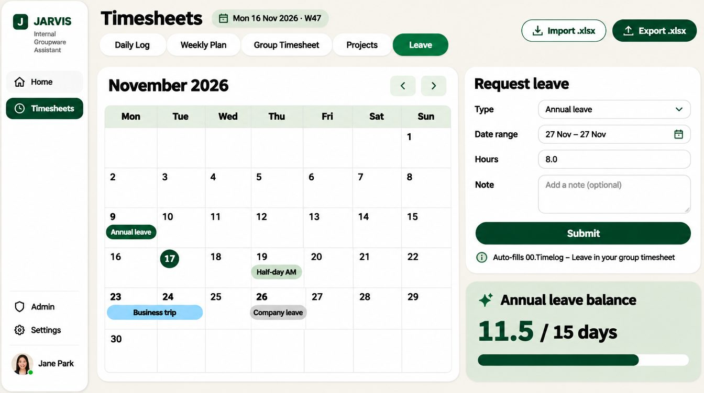
- 월간 캘린더에 연차/반차/회사지정휴가/출장 막대를 표시합니다.
- 신청 폼(유형·기간·시간·메모)을 내면 **`00.Timelog--Leave` 행에 자동 기입**됩니다. Company Leave와 Biz Trip은 각자 해당 로컬 섹션 행으로 들어갑니다.
- 잔여 연차 카드.

### 07 · Settings
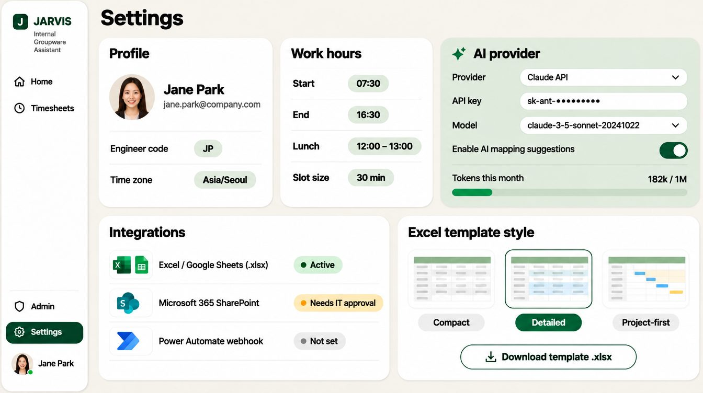
- Profile(엔지니어 코드는 그룹 시트 열 이름과 매칭), Work hours(근무·점심·slot 크기).
- **AI provider**: 키 입력, 모델 선택, 매핑 제안 on/off, 월 토큰 사용량.
- **Integrations**: Excel/Google Sheets, SharePoint, Power Automate 웹훅 상태.
- **Excel template style**: Compact / Detailed / Project-first 중 선택 후 다운로드(§9).

### 08 · Admin › Users
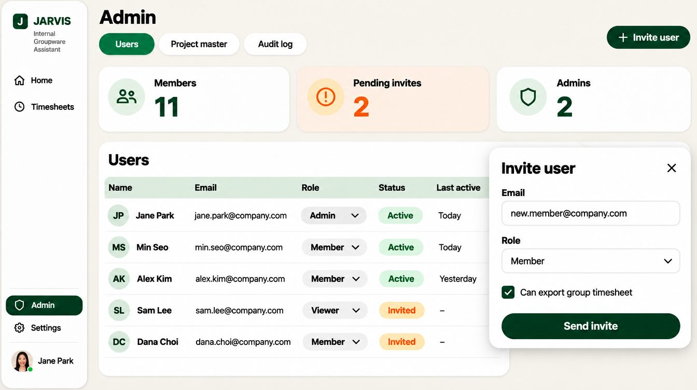
- 멤버/대기 초대/관리자 수.
- 사용자 테이블: 역할(Admin/Member/Viewer) 변경, 상태(Active/Invited).
- **Invite user 모달**: 이메일, 역할, 권한 플래그(예: 그룹 timesheet export 허용).
- 탭: Project master(마스터 시트 import 권한), Audit log.

### 09 · Import & Convert 마법사
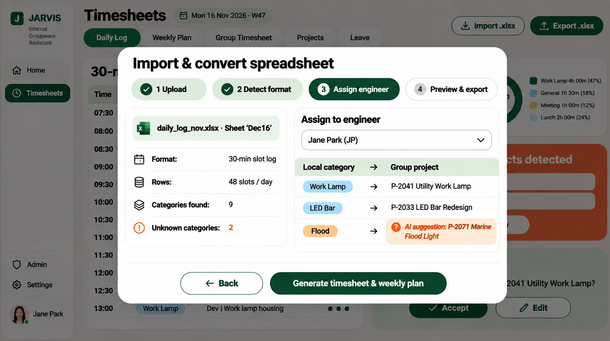
- **1 Upload → 2 Detect format → 3 Assign engineer → 4 Preview & export**
- 형식 감지: 30분 slot 로그인지, slot 수, 카테고리 수, 미확인 카테고리 수.
- **담당자 지정** 후 `로컬 카테고리 → 그룹 프로젝트` 매핑을 확인합니다. 미확인 항목은 AI가 제안합니다.
- 결과로 **Group Timesheet + Weekly Plan**이 동시에 생성됩니다.

### 컨셉 이미지의 알려진 한계 (본 개발 때 무시할 것)
- 숫자는 **장식용**입니다. 04의 행 합계와 열 합계가 맞지 않고, 00 도넛의 Lunch 2h도 마찬가지입니다.
- 07의 모델 드롭다운에 보이는 `claude-3-5-sonnet-…`는 이미지 모델이 지어낸 **구버전 ID**입니다. 실제 기본값은 §7을 따릅니다.
- 05의 `NEW` 칩은 노랑으로 렌더링됐지만, 의도한 색은 `--accent` 오렌지입니다.
- 01의 Microsoft/Google 버튼은 SSO 자리 표시입니다. 실제로 켤지는 IT 정책에 따라 정합니다.

## 6. 데이터 모델 초안 (Postgres)

| 테이블 | 주요 컬럼 | 비고 |
|---|---|---|
| `profiles` | `id`(=auth user), `name`, `engineer_code`, `role`(admin/member/viewer), `can_export`, `timezone`, `work_start`, `work_end` | 엔지니어 코드 = 그룹 시트 열 헤더 |
| `invitations` | `email`, `role`, `invited_by`, `status`, `expires_at` | 발송은 Auth 초대 API |
| `group_projects` | `code`, `name`, `kind`(project/timelog/local_section), `sort_order`, `status`, `first_seen_import_id`, `last_seen_import_id` | 신규 = `first_seen_import_id` = 최신 import |
| `project_aliases` | `group_project_id`, `alias`, `owner_id`(null=팀 공용) | 1:N |
| `master_imports` | `file_name`, `source`(manual/graph/power_automate), `uploaded_by`, `added`, `removed` | diff 결과 보관 |
| `time_slots` | `user_id`, `date`, `slot_start`, `category_raw`, `group_project_id`, `description`, `focus`(0–3), `rating`(1–5) | `unique(user_id, date, slot_start)` |
| `work_blocks` (view) | 연속 slot 병합 결과 | Weekly Plan 원천 |
| `leave_requests` | `user_id`, `type`, `start_date`, `end_date`, `hours`, `note`, `status` | Leave 행 자동 반영 |
| `ai_usage` | `user_id`, `feature`, `model`, `input_tokens`, `output_tokens` | 월 한도·비용 추적 |
| `audit_log` | `actor`, `action`, `target`, `payload` | 관리자 작업 기록 |

권한(RLS): Member는 본인 `time_slots`/`leave_requests`만 읽고 쓸 수 있습니다. Viewer는 읽기 전용, Admin은 전체 + 마스터/초대 관리.

## 7. 권장 기술 스택

| 영역 | 선택 | 메모 |
|---|---|---|
| Frontend | React + Vite + TypeScript, React Router, TanStack Query | 요청사항: React |
| UI | Tailwind CSS + shadcn/ui(Radix), Recharts | Bento 카드·칩·도넛 |
| 스프레드시트 그리드 | **PoC 후보**: Glide Data Grid(MIT), Jspreadsheet CE(MIT) | Excel 복붙과 셀 드롭다운이 필수입니다. AG Grid Community는 클립보드·범위선택이 Enterprise 기능이고, Handsontable은 상용 라이선스가 필요해 후순위입니다 |
| Excel 입출력 | **ExcelJS**(MIT) | 스타일·데이터 유효성·조건부서식까지 쓸 수 있어 템플릿과 그룹 포맷 출력에 적합합니다. SheetJS CE는 파싱 보조용입니다(스타일 쓰기는 Pro 기능, npm 레지스트리 버전은 구버전) |
| DB / Auth / 서버 | **Supabase** (Postgres + RLS + Auth + Edge Functions + Storage) | 이메일 magic link, 관리자 초대(`auth.admin.inviteUserByEmail`), Azure(Entra ID)/Google OAuth를 지원합니다 |
| 호스팅 | Vercel / Netlify / Cloudflare Pages + Supabase Cloud | 사내 정책상 필요하면 Supabase를 self-host할 수 있습니다 |

## 8. SharePoint 연동 가이드

그룹 시트를 SharePoint에서 **자동으로** 가져오려면 대부분 **회사 IT(Microsoft 365 관리자)의 승인**이 필요합니다. 그래서 단계적으로 접근하길 권합니다.

| 옵션 | 방식 | 필요 조건 | 권장 |
|---|---|---|---|
| **A. 수동 업로드** | SharePoint에서 파일 › 다운로드(.xlsx) → Projects 탭에 드롭 → diff로 신규 감지 | 없음 | **1단계 기본** |
| **B. Microsoft Graph API** | Entra ID 앱 등록 → 해당 사이트 파일 읽기. `GET /sites/{hostname}:/sites/{path}` → `GET /drives/{drive-id}/items/{item-id}/workbook/worksheets('{sheet}')/usedRange` 또는 `/content` 다운로드. 변경 감지는 `GET /drives/{drive-id}/root/delta` 주기 조회, 또는 driveItem 변경 알림(subscription) | 테넌트 관리자 동의. 최소 권한은 **`Sites.Selected`**(해당 사이트만 허용). 넓게 쓰면 `Sites.Read.All` | IT 승인 시 **2단계** |
| **C. Power Automate** | 트리거 "When a file is created or modified (properties only)" → "Get file content" → JARVIS 웹훅으로 HTTP POST | Power Automate 사용 권한. **HTTP 액션은 Premium 라이선스** | B가 어렵고 Premium이 있을 때 |
| C′. Power Automate (무료 우회) | 같은 트리거 → 파일을 첨부해 전용 메일함으로 발송 → JARVIS가 메일함을 읽음 | 메일함 연동 필요 | 대안 |

- B와 C를 쓰더라도 **diff, 신규 감지, 알림 로직은 A와 같습니다**. 그러니 A부터 구현하면 버리는 코드가 없습니다.
- 같은 Entra ID 앱으로 **Microsoft SSO 로그인**까지 묶을 수 있습니다. IT에 한 번에 요청하세요.

## 9. Excel 템플릿 (담당자 스타일 제안)

모든 템플릿에는 숨김 시트 `_meta`(template id, version, engineer code)와 `_lists`(카테고리/alias 목록)를 넣습니다. 그러면 **Import 때 AI 없이도 형식을 확정**할 수 있습니다. 구분 열은 데이터 유효성 드롭다운으로 만듭니다.

| 스타일 | 대상 | 구성 |
|---|---|---|
| **Compact** | 최소 입력 선호 | 시간 · 구분 · 내용 3열, 근무시간대만 |
| **Detailed** | 현재 개인 시트 사용자 | 48 slot · 구분 · 내용 · 몰입도 · 평가 + 요약 패널(결과보고/종합의견/파이차트). 기존 Google Sheet와 가장 유사합니다 |
| **Project-first** | 프로젝트 위주 기록 | 행=slot, 열=내 프로젝트(alias). 셀에 표시만 하는 간트형 |

Google Sheets 사용자는 템플릿을 업로드해 그대로 쓰다가 `파일 › 다운로드 › .xlsx`로 내보내서 Import하면 됩니다.

## 10. AI 사용 범위 (옵션, API 키 연동)

**AI는 필수가 아닙니다.** 파싱, 집계, diff, 검증, 출력은 모두 결정론적 로직으로 처리합니다. AI는 아래 **보조 기능에만 옵트인**으로 씁니다.

1. **매핑 제안**: alias 테이블과 퍼지매칭(정규화·음차 사전)으로도 안 풀린 항목만 AI에게 보냅니다. 예: `플루드램프` ↔ `Marine Flood Light`.
2. **비정형 시트 해석**: `_meta`가 없는 임의 형식 시트는 **헤더와 앞 몇 행만** 보내서 열 의미를 JSON(structured outputs)으로 받습니다.
3. (선택) Weekly Plan의 Item 문구 정리.

- 구현: **서버(Edge Function)에서만 호출**합니다. API 키는 서버 시크릿에 두고 클라이언트에 노출하지 않습니다. 사용자·조직별 월 토큰 한도를 두고 `ai_usage`에 기록합니다.
- 모델: 기본 `claude-opus-5-5`($4 / $20 per 1M tokens). Settings에서 조직이 다른 모델을 고를 수 있습니다.
- 비용 추정(`claude-opus-5-5` 기준): 매핑 1회(입력 약 2k, 출력 약 0.3k 토큰)에 약 $0.014, 시트 해석 1회(약 5k / 1k)에 약 $0.04. 11명이 월 20회씩 쓰면 **월 몇 달러 수준**입니다.
- 사내 정보(프로젝트명, 업무 내용)가 외부 API로 나가므로, **회사 보안 정책을 먼저 확인**하세요. 필요하면 마스킹 옵션을 둡니다.

## 11. 다음 단계

1. 컨셉 피드백 반영. 필요하면 확정 화면만 2k로 재생성합니다(`higgsfield/prompts.json` 재사용).
2. 익명화한 실제 그룹 마스터 xlsx 샘플을 확보해 파서 스펙을 확정합니다(병합 셀, 날짜 블록 반복 구조).
3. Supabase 프로젝트, 스키마, RLS, 초대·로그인 플로우를 셋업합니다.
4. Daily Log 그리드 PoC(Glide vs Jspreadsheet CE): 복붙, 드롭다운, 키보드 입력을 검증합니다.
5. ExcelJS로 출력 3종(그룹 포맷 / 주간계획 / 템플릿 3스타일)을 만듭니다.
6. IT에 SharePoint 연동(Graph `Sites.Selected` 또는 Power Automate)과 SSO 승인을 요청합니다.
7. AI 매핑 제안(옵트인)과 토큰 한도를 붙입니다.
